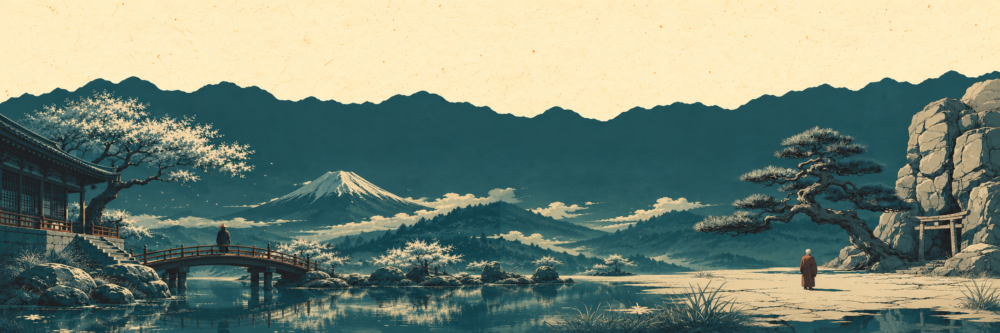
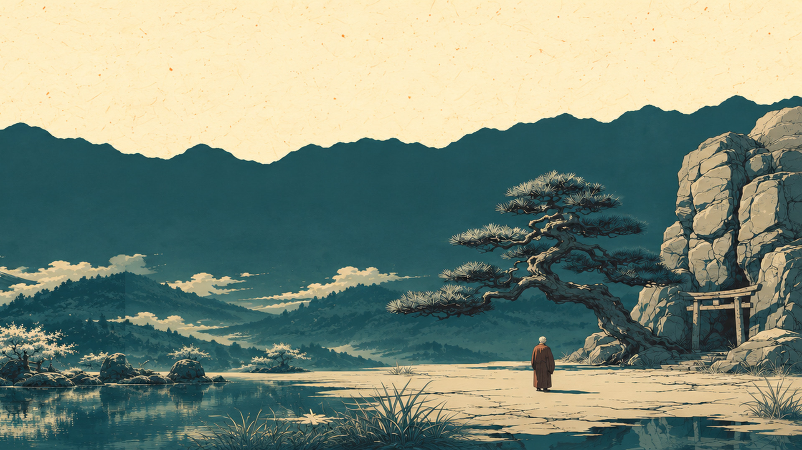
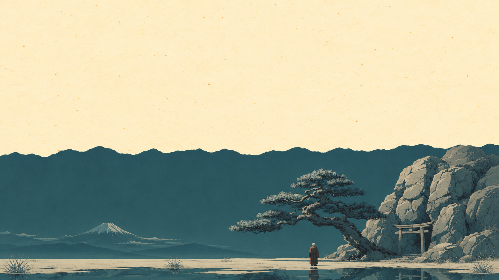
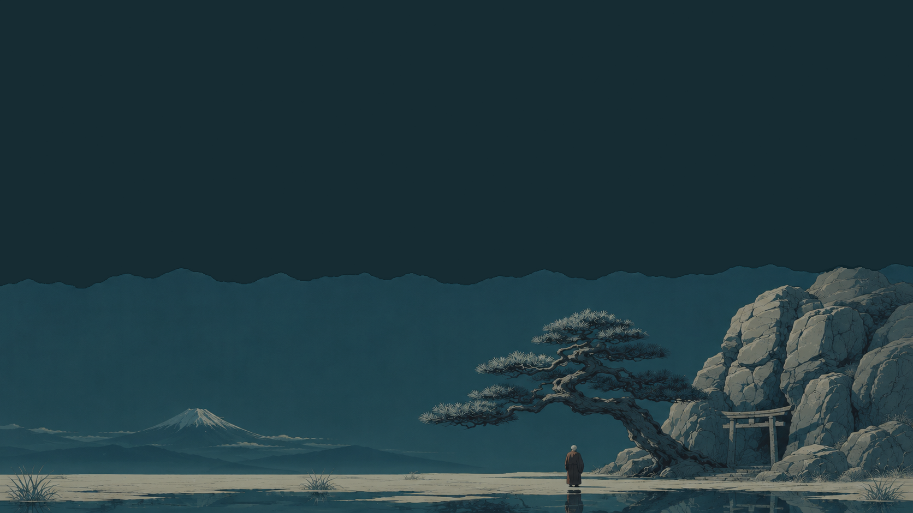
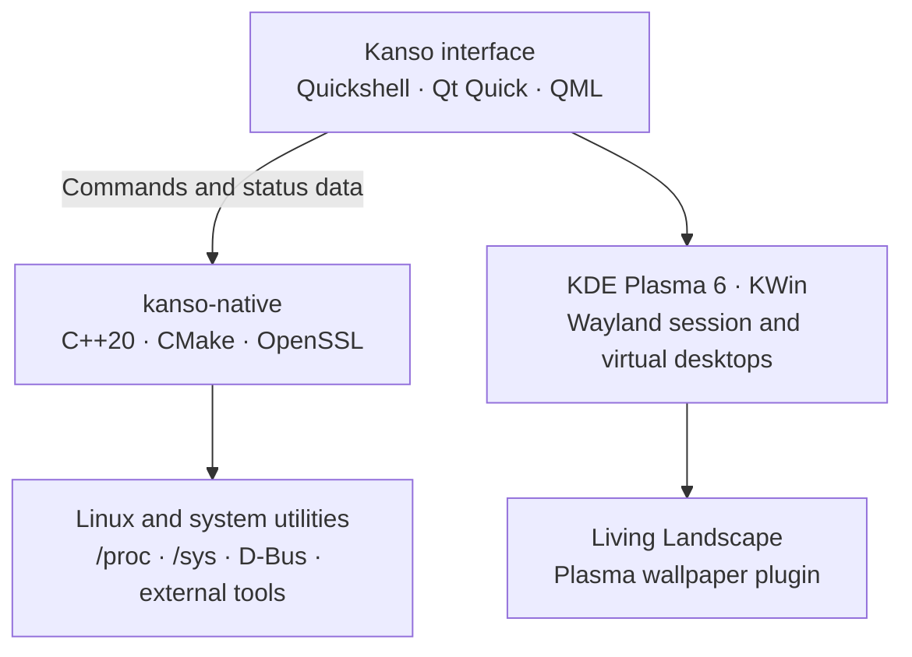

<div align="center">

# K A N S O

### 簡素 — The art of less.

**Four workspaces. One uninterrupted landscape.**

A personal desktop for **KDE Plasma 6 · Wayland**, built with **Quickshell, QML and C++20**.

<br>



<sub>The landscape behind Kanso. Original illustrations by Artzeene; panoramic adaptation for Kanso.</sub>

<br><br>

[**Explore**](#the-idea) &nbsp;·&nbsp; [**The landscape**](#four-desktops-one-landscape) &nbsp;·&nbsp; [**Features**](#the-desktop) &nbsp;·&nbsp; [**Installation**](#installation) &nbsp;·&nbsp; [**Credits**](#artwork--credits)

</div>

---

## The idea

A desktop should feel like somewhere you want to spend time, not another thing asking for your attention.

Kanso takes its name from **簡素**, the Japanese idea of simplicity without unnecessary ornament. The design is built around warm paper tones, dark teal, a little motion, and plenty of empty space. There is a panel for the things worth knowing, a dock for the things worth opening, and very little else in the way.

Underneath, it's still KDE Plasma. KWin handles windows and virtual desktops; Quickshell handles the interface. Kanso connects the two, rather than trying to replace either one.

## Four desktops, one landscape

The wallpaper isn't four unrelated pictures. It's a continuous scene that follows the active virtual desktop. Moving between workspaces reveals another part of the landscape while keeping KWin's native transitions intact.

<table>
  <tr>
    <td width="50%"></td>
    <td width="50%"></td>
  </tr>
  <tr>
    <td><sub><strong>01</strong> — The beginning</sub></td>
    <td><sub><strong>02</strong> — Further along</sub></td>
  </tr>
  <tr>
    <td></td>
    <td></td>
  </tr>
  <tr>
    <td><sub><strong>03</strong> — Another view</sub></td>
    <td><sub><strong>04</strong> — The other end</sub></td>
  </tr>
</table>

The continuity comes from a custom **Plasma wallpaper plugin**, working with KWin's virtual-desktop state. These images show the landscape artwork, rather than screenshots of the panel or dock.

## Day / Night

Kanso has two appearances. Day uses a pale, paper-like palette; Night moves to muted blues and warmer, softer contrast. You can switch manually or let Kanso follow the time of day.

<table>
  <tr>
    <td width="50%"></td>
    <td width="50%"></td>
  </tr>
  <tr>
    <td align="center"><strong>DAY</strong><br><sub>Paper · warmth · daylight</sub></td>
    <td align="center"><strong>NIGHT</strong><br><sub>Ink · quiet · dusk</sub></td>
  </tr>
</table>

The change goes beyond the background. Kanso can coordinate KDE colors, its own UI, Alacritty, Firefox, VS Code and the lock screen. Automatic switching is time-based; the running shell uses the native C++ core to apply the changes.

## The desktop

| Part | What it does |
| :--- | :--- |
| **Panel** | Workspaces, clock, system information, network, Bluetooth, media, volume, brightness, battery, notifications and updates. |
| **Dock** | An unobtrusive application dock with running-window indicators, previews and auto-reveal behavior. |
| **Start menu** | Searchable applications, categories, favorites and system actions, built directly in QML. |
| **Living Landscape** | A panoramic wallpaper that follows four KDE virtual desktops without replacing KWin's transitions. |
| **Day / Night** | Manual and automatic appearance switching, with coordinated colors across supported applications. |
| **Native Core** | System status, keyboard locks, Rofi, power actions, update launching, window selection, icon management and diagnostics. |
| **Personal touches** | Kanso icon theme and configurations for tools such as Alacritty, Fish, Neovim and VS Code. |

Nothing here is intended to replace KDE's window manager or system services. The dock, panel and menus belong to Quickshell; everything else stays where it makes sense.

## Under the hood

<div align="center">

**QML on the surface. C++20 underneath. KDE at the foundation.**

</div>



The C++ core is a small, **on-demand executable** rather than a background daemon. Quickshell launches it for system information or an action. The UI itself is written in QML, with JavaScript where appropriate.

<details>
<summary><strong>And the Python?</strong></summary>

<br>

There is one Python file in the repository: [`kanso/install.py`](kanso/install.py).

It runs **only during installation**. The panel, launcher, Day/Night switching and native system commands don't depend on a running Python process. I kept the standalone installer because replacing working setup code just to eliminate one file wasn't worth the complexity.

Some older maintenance tools from earlier iterations — including parts of first-time login configuration and application-theme restoration — are not part of this native release.

</details>

## Installation

Kanso was developed on **CachyOS with KDE Plasma 6 and Wayland**. It should be approachable on other Arch-based systems, but it is still a personal rice, not a turn-key desktop distribution.

**Before you begin:** back up your KDE settings and any existing Quickshell configuration. Kanso expects `~/Rice/kanso`; don't launch a second copy alongside another Quickshell panel.

### 1. Get Kanso

```bash
mkdir -p ~/Projects ~/Rice
git clone https://github.com/Werdna09/Kanso-ricing.git ~/Projects/Kanso-ricing

# Standalone installer; refuses to overwrite an existing Kanso by default.
python3 ~/Projects/Kanso-ricing/kanso/install.py
```

### 2. Build the native core

You'll need a **C++20 compiler**, **CMake 3.20+** and **OpenSSL development files**. Quickshell and KDE Plasma 6 are required for the desktop itself. Depending on which controls you use, also install the corresponding tools (for example Rofi, Alacritty, `kdotool`, `qdbus6`, `brightnessctl`, `checkupdates` and `paru`).

```bash
cmake -S ~/Rice/kanso/native -B ~/Rice/kanso/native/build \
  -DCMAKE_BUILD_TYPE=Release
cmake --build ~/Rice/kanso/native/build --parallel 2
install -Dm755 ~/Rice/kanso/native/build/kanso-native \
  ~/Rice/kanso/native/bin/kanso-native
```

Check that the binary works before starting the shell:

```bash
~/Rice/kanso/native/bin/kanso-native status
~/Rice/kanso/native/bin/kanso-native doctor preflight
~/Rice/kanso/native/bin/kanso-native doctor audit
```

### 3. Install Living Landscape

The wallpaper plugin is separate from the Quickshell configuration:

```bash
mkdir -p ~/.local/share/plasma/wallpapers
cp -a ~/Projects/Kanso-ricing/wallpaper/org.kanso.livinglandscape \
  ~/.local/share/plasma/wallpapers/
```

Select **Living Landscape** in KDE's wallpaper settings. The day and night artwork is bundled in the respective Kanso and wallpaper-plugin folders. To reproduce the four-desktop view, configure four virtual desktops in KDE.

### 4. Start the shell

```bash
qs -p ~/Rice/kanso
```

Try it manually before adding it to autostart. Setting up KDE shortcuts, application themes and other personal integrations may require additional local configuration; the installer doesn't rewrite your entire desktop session.

<details>
<summary><strong>Native command reference</strong></summary>

<br>

These examples use `~/Rice/kanso/native/bin/kanso-native` as the executable path:

```bash
~/Rice/kanso/native/bin/kanso-native status
~/Rice/kanso/native/bin/kanso-native locks
~/Rice/kanso/native/bin/kanso-native rofi
~/Rice/kanso/native/bin/kanso-native windows
~/Rice/kanso/native/bin/kanso-native icons status
~/Rice/kanso/native/bin/kanso-native shortcut audit
~/Rice/kanso/native/bin/kanso-native updates --print
~/Rice/kanso/native/bin/kanso-native power reboot --dry-run
~/Rice/kanso/native/bin/kanso-native doctor audit
```

`--dry-run` inspects a power action without executing it. System actions in the UI use confirmation where appropriate.

</details>

## Repository layout

```text
Kanso-ricing/
├── kanso/
│   ├── shell.qml                  Quickshell entry point
│   ├── components/               Panel, dock and common widgets
│   ├── popups/                   Start menu and system controls
│   ├── services/                 KDE and system integrations
│   ├── native/                   C++20 source and CMake build
│   ├── config/                   Application themes and settings
│   ├── icon-theme/               Kanso SVG icons
│   ├── living-landscape/         Individual workspace artwork
│   └── install.py                Setup-time installer
├── wallpaper/
│   └── org.kanso.livinglandscape/   Plasma wallpaper plugin
├── ARTWORK.md                    Art attribution and usage notes
└── README.md
```

## Artwork & credits

The landscape shown above uses **original illustrations by [Artzeene](ARTWORK.md)**. I purchased the artwork, adapted it into the four-workspace panorama and prepared a corresponding night treatment. The underlying illustrations are Artzeene's work, not mine.

These images are included in this repository, but **the artwork is separate from the software source**. Its presence here does not grant others permission to copy, modify or redistribute it. The applicable permissions depend on the artist's license or authorization; see [ARTWORK.md](ARTWORK.md).

Kanso is an independent personal project, unaffiliated with KDE, Quickshell, CachyOS or Artzeene. Product names, icons and third-party assets belong to their respective owners.

## Project notes

Kanso is shared because I enjoy building and refining my own desktop, and because some of the pieces may be useful to others. Feedback, bug reports and thoughtful changes are welcome — particularly around portability, reliability and the native core.

Please keep the visual restraint, preserve KWin's behavior and don't commit personal configuration files or artwork you aren't allowed to redistribute. The repository currently has **no general-purpose source-code license**; public access alone doesn't grant reuse or redistribution rights.

---

<div align="center">

### 簡素

**Keep what matters. Leave room for everything else.**

<sub>Kanso · built for the space between windows.</sub>

</div>
